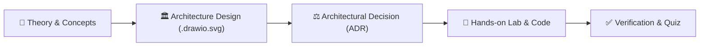

# 📚 Master Learning Hub & Architecture Index

Welcome to the centralized documentation hub for the **AWS Hands-on Training Labs**. This index connects the 10-week curriculum, architectural blueprints, Architecture Decision Records (ADRs), security models, and operational runbooks.

---

## 🧭 Navigation & Learning Model

Each lesson follows a strict **Production-Ready Engineering Loop**:

---

## 🗓️ Weekly Curriculum & Daily Index

### [Week 01: AWS Fundamentals & Account Security](../labs/week-01-fundamentals/README.md)
*Focus: Global Infrastructure, Account Hardening, IAM, MFA, and AWS CLI v2.*
- [x] **[Day 01: Global Infrastructure, High Availability & Shared Responsibility](../labs/week-01-fundamentals/day-01/day-01-notes.md)**
  - 🏛️ Architecture: [Multi-AZ ERP Architecture Blueprint](./architecture/day01/erp-multi-az.drawio.svg)
  - ⚖️ Decision Record: [ADR-001: AWS Primary Region Selection](./adr/ADR-001-region-selection.md)
  - 🎮 Interactive Exercise: [day-01.html](../labs/week-01-fundamentals/day-01/day-01.html)
- [ ] **Day 02: AWS Account Security, Root Protection & MFA** *(Planned)*
- [ ] **Day 03: IAM Fundamentals: Users, Groups, Roles & Policies** *(Planned)*
- [ ] **Day 04: AWS CLI v2 Setup & Least-Privilege Identity Management** *(Planned)*
- [ ] **Day 05: Billing Alerts, AWS Budgets & CIS Benchmark Audit** *(Planned)*

---

### [Week 02: Networking & Multi-AZ VPC Architecture](../labs/week-02-networking/)
*Focus: Custom VPC, Public/Private Subnets, Internet Gateways, NAT Gateways, Security Groups, NACLs.*
- [ ] Day 06: VPC Fundamentals & CIDR Subnetting Calculations
- [ ] Day 07: Routing Tables, Internet Gateway & NAT Gateways
- [ ] Day 08: Deep Dive into Security Groups vs. Network ACLs
- [ ] Day 09: VPC Flow Logs & Network Troubleshooting
- [ ] Day 10: Multi-AZ Tiered VPC Baseline Synthesis

---

### [Week 03: Storage Services & S3 Integration](../labs/week-03-s3/)
*Focus: S3 Buckets, Lifecycle Rules, Presigned URLs, KMS Encryption, NestJS SDK.*
- [ ] Day 11: Amazon S3 Storage Classes & Lifecycle Transitions
- [ ] Day 12: Bucket Policies, Block Public Access & KMS Server-Side Encryption
- [ ] Day 13: NestJS Backend: Secure File Upload via Presigned URLs
- [ ] Day 14: S3 Multipart Uploads & Large File Streaming
- [ ] Day 15: Cross-Region Replication (CRR) & Storage Cost Optimization

---

### [Week 04: Compute & Serverless](../labs/week-04-lambda/)
*Focus: EC2 Basics, AWS Lambda, API Gateway, TypeScript Serverless REST API.*
- [ ] Day 16: EC2 Instance Types, Key Pairs, and User Data Scripts
- [ ] Day 17: AWS Lambda Internals: Execution Environment & Lifecycle
- [ ] Day 18: Lambda Cold Starts, Concurrency, and Memory Tuning
- [ ] Day 19: API Gateway (HTTP vs REST API) Integration with Lambda
- [ ] Day 20: Serverless NestJS / TypeScript Microservice

---

### [Week 05: Databases (Relational & NoSQL)](../labs/week-05-database/)
*Focus: Amazon RDS (PostgreSQL/MySQL), DynamoDB Single-Table Design, Backups.*
- [ ] Day 21: RDS Multi-AZ vs. Read Replicas
- [ ] Day 22: RDS Automated Backups, Snapshots & Point-in-Time Recovery (PITR)
- [ ] Day 23: DynamoDB Core Concepts: Partition Keys, Sort Keys & Indexes (GSI/LSI)
- [ ] Day 24: DynamoDB Single-Table Design for High-Throughput Workloads
- [ ] Day 25: Database Caching with Amazon ElastiCache (Redis)

---

### [Week 06: Event-Driven Architecture](../labs/week-06-messaging/)
*Focus: Amazon SQS, SNS, EventBridge, Dead Letter Queues (DLQ), Idempotency.*
- [ ] Day 26: Decoupling with SQS: Standard vs. FIFO Queues
- [ ] Day 27: Pub/Sub Notifications with Amazon SNS & Fanout Pattern
- [ ] Day 28: Event Routing & Choreography with Amazon EventBridge
- [ ] Day 29: Resilience: Retry Policies, Exponential Backoff & DLQs
- [ ] Day 30: NestJS Background Worker with Idempotent Message Processing

---

### [Week 07: Observability & Auditing](../labs/week-07-observability/)
*Focus: CloudWatch Logs, Metrics, Alarms, CloudTrail Auditing, AWS X-Ray Tracing.*
- [ ] Day 31: Centralized Structured Logging with CloudWatch Logs Insights
- [ ] Day 32: Custom Metrics, Metric Filters & Composite Alarms
- [ ] Day 33: AWS CloudTrail: Governance, Compliance & Security Auditing
- [ ] Day 34: Distributed Tracing with AWS X-Ray & OpenTelemetry
- [ ] Day 35: Central Observability Dashboard & Alerting to Slack/Email

---

### [Week 08: Containers & CI/CD](../labs/week-08-containers/)
*Focus: Docker, Amazon ECR, Amazon ECS with AWS Fargate, GitHub Actions.*
- [ ] Day 36: Production Multi-Stage Dockerfile for NestJS
- [ ] Day 37: Amazon ECR: Repository Policies, Image Scanning & Immutability
- [ ] Day 38: Amazon ECS & Fargate: Task Definitions, Services & Task Execution Roles
- [ ] Day 39: Application Load Balancer (ALB) Routing & Health Checks
- [ ] Day 40: Automated GitHub Actions Pipeline: Test, Build, Push & ECS Deploy

---

### [Week 09: Infrastructure as Code (IaC)](../labs/week-09-iac/)
*Focus: AWS CDK (TypeScript) / Terraform, Environments, Drift Detection.*
- [ ] Day 41: IaC Paradigms: Declarative vs. Imperative (Terraform vs. CDK)
- [ ] Day 42: AWS CDK Fundamentals: Stacks, Constructs (L1/L2/L3), and Context
- [ ] Day 43: Provisioning Multi-AZ VPC & Database using CDK
- [ ] Day 44: Multi-Environment Deployments (dev, staging, prod) & Parameter Store
- [ ] Day 45: CDK Pipelines & GitOps-driven Infrastructure Releases

---

### [Week 10: Production Architecture & Capstone](../labs/week-10-capstone/)
*Focus: Well-Architected Review, High Availability, Disaster Recovery, Cost Optimization.*
- [ ] Day 46: AWS Well-Architected Framework: 6 Pillars Deep Dive
- [ ] Day 47: Disaster Recovery Strategies: Backup & Restore vs. Pilot Light vs. Active-Active
- [ ] Day 48: Threat Modeling & Security Posture Review (STRIDE / AWS Security Hub)
- [ ] Day 49: Cost Optimization: Compute Savings Plans, Reserved Instances & Right-sizing
- [ ] Day 50: Final Capstone Defense: Enterprise ERP Multi-AZ Production Architecture

---

## 🗂️ Central Artifacts Directory

| Category | Location | Purpose |
|:---|:---|:---|
| **Architecture Blueprints** | [docs/architecture/](./architecture/) | Editable `.drawio` files and high-res vector `.svg` diagrams |
| **Decision Records (ADR)** | [docs/adr/](./adr/) | Formal architectural choices, trade-offs, and justification logs |
| **Security Checklists** | [docs/security/](./security/) | IAM baselines, CIS benchmarks, and least-privilege policies |
| **Cost Models** | [docs/cost/](./cost/) | AWS Pricing Calculator worksheets and monthly bill projections |
| **Operational Runbooks** | [docs/runbooks/](./runbooks/) | Disaster recovery steps, failover validation, and rollback guides |
