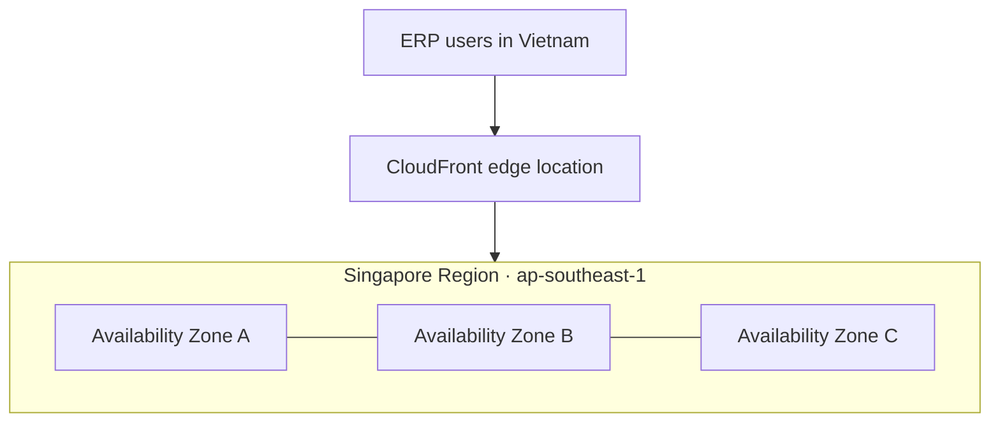
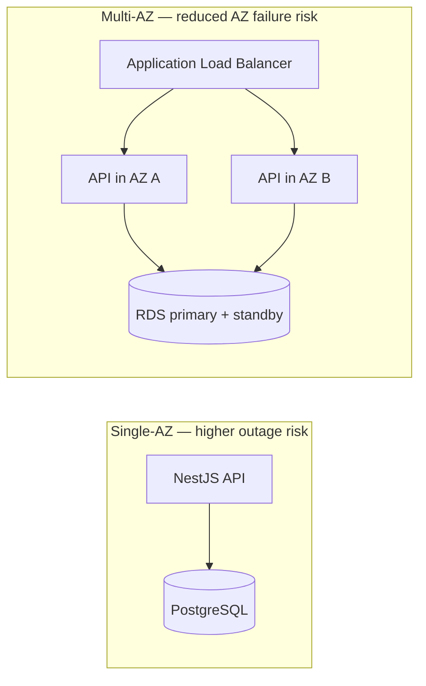
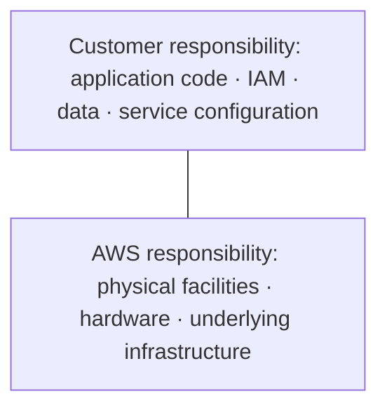
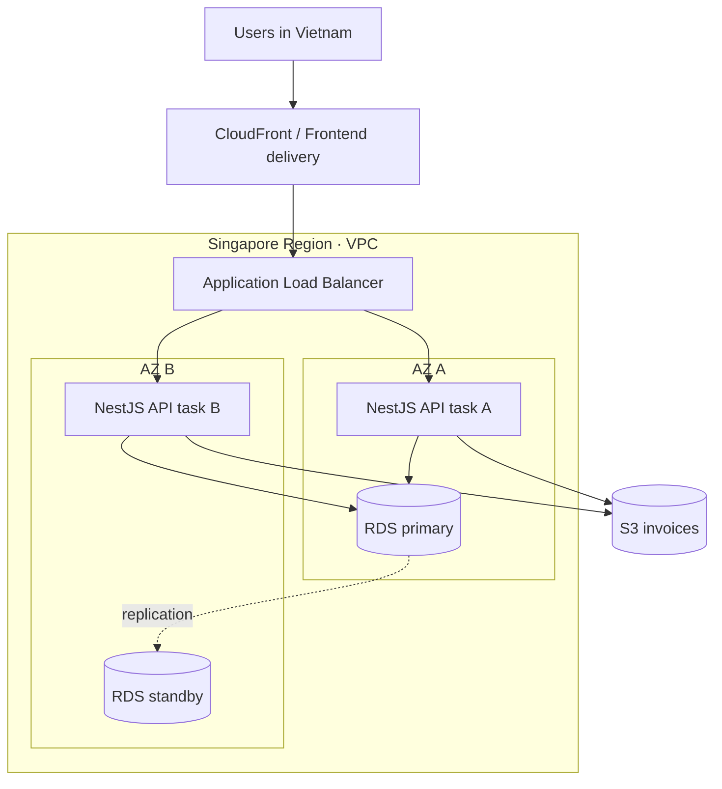

# AWS Training · Week 01 / Day 01

> **Global Infrastructure, High Availability & Shared Responsibility**  
> **Duration:** 45 minutes · **Level:** Fundamentals

> **Visual guide:** The Mermaid architecture diagrams below render in GitHub and other Mermaid-enabled Markdown viewers.

## Learning outcomes

By the end of this lesson, you should be able to:

- [ ] Explain the difference between an AWS Region, Availability Zone (AZ), and edge location.
- [ ] Choose a candidate Region for an ERP serving customers in Vietnam.
- [ ] Explain why Multi-AZ improves availability but does not replace backups or disaster recovery.
- [ ] Assign security responsibilities to AWS or the customer for EC2, S3, RDS, and Lambda.
- [ ] Sketch a secure, highly available NestJS + Next.js ERP architecture.

## 45-minute learning plan

| Time | Activity | Output |
|---|---|---|
| 00–10 min | Global infrastructure | Region/AZ/edge definitions |
| 10–15 min | Availability and disaster recovery | Failure scenario notes |
| 15–20 min | Shared responsibility | Responsibility matrix |
| 20–35 min | Hands-on design | Region decision + architecture diagram |
| 35–45 min | Quiz and review | Quiz score + checklist |

---

## Part 1 — AWS Global Infrastructure (10 min)

### 1.1 Region

An **AWS Region** is a separate geographic area where AWS operates cloud infrastructure. A Region contains multiple isolated Availability Zones. Many AWS services and resources are Region-scoped; the Region you choose affects latency, service availability, data residency, and cost.

**Example:** `ap-southeast-1` is the Asia Pacific (Singapore) Region.

### 1.2 Availability Zone (AZ)

An **Availability Zone** consists of one or more discrete data centers with independent power, networking, and connectivity. AZs within a Region are connected by high-bandwidth, low-latency networking. Some resources, such as EC2 instances and VPC subnets, are placed in specific AZs.

**Important:** AZ letters (for example, `ap-southeast-1a`) may map to different physical AZs across AWS accounts. Do not assume identical AZ letter labels mean the same physical location in different accounts.

### 1.3 Edge location

An **edge location** is part of AWS's distributed network used by services such as Amazon CloudFront to deliver cached content closer to users. Edge locations are not interchangeable with Regions or general-purpose AZs.



### Scope comparison

| Concept | Main purpose | Example |
|---|---|---|
| Region | Geographic deployment and data location | `ap-southeast-1` |
| Availability Zone | Fault isolation inside a Region | AZ A, AZ B |
| Edge location | Content delivery near users | CloudFront cache |

> **Engineering takeaway:** Place latency-sensitive application and database workloads in the same Region. Spread critical services across AZs where appropriate.

---

## Part 2 — Availability, Resilience & Disaster Recovery (5 min)

**High availability (HA)** reduces service interruption from component or AZ failures. **Disaster recovery (DR)** defines how to restore operations after a major incident, potentially including Region-wide failure or data corruption.

### Single-AZ versus Multi-AZ



| Design | Benefit | Limitation |
|---|---|---|
| Single-AZ | Simpler and often cheaper | AZ failure can cause an outage |
| Multi-AZ | Better AZ fault tolerance | Higher cost; does not prevent Region-wide failure |
| Backups + tested restore | Recovery from deletion/corruption | Restore takes time |
| Multi-Region DR | Addresses certain Region-wide failures | More complexity and cost |

**RTO** = maximum acceptable time to restore service. **RPO** = maximum acceptable amount of data loss measured in time.

**Scenario:** If an administrator accidentally deletes customer records, an RDS standby may replicate the deletion. Multi-AZ is not a substitute for point-in-time recovery and restore testing.

---

## Part 3 — Shared Responsibility Model (5 min)

AWS secures the **cloud infrastructure** (*security of the cloud*). Customers secure their **workloads, identities, data, and configurations** (*security in the cloud*). The boundary varies by service.



| Service | AWS manages | Customer manages |
|---|---|---|
| EC2 | Physical hosts and underlying infrastructure | Guest OS patching, application, security groups, IAM |
| S3 | Storage service infrastructure | Bucket/object access policies, data classification, application authorization |
| RDS | Managed DB infrastructure and specified maintenance tasks | DB accounts, schema, data, backup/retention settings, connectivity |
| Lambda | Managed execution infrastructure | Function code, dependencies, IAM permissions, data handling |

**ERP security examples:**

1. A publicly readable bucket exposes invoices → customer configuration failure.
2. An unpatched NestJS dependency is exploited → customer application security responsibility.
3. Physical server failure in an AWS data center → AWS infrastructure responsibility.
4. An overly broad Lambda execution role reads unrelated data → customer IAM responsibility.

> **Rule:** Managed does not mean responsibility-free. Read the responsibility split for each AWS service.

---

## Part 4 — Hands-on: Design an ERP for Vietnam (15 min)

**Constraints:** No AWS deployment. Use diagrams.net, Mermaid, or paper. All exercises cost $0.

### Exercise A — Region decision (5 min)

**Scenario:** 95% of ERP users are in Vietnam. The stack is Next.js, NestJS, PostgreSQL, and S3. The system handles invoices and customer data.

**Candidate:** Singapore (`ap-southeast-1`). Evaluate:

| Criterion | Working hypothesis | Validation |
|---|---|---|
| Latency | Singapore is a reasonable starting candidate | Measure from representative Vietnamese ISPs and API clients |
| Availability | Multi-AZ deployment is possible | Verify service/AZ availability and failover design |
| Compliance | Cross-border personal-data handling may create obligations | Review current Vietnamese law and sector-specific requirements |
| Cost | Price varies by Region and architecture | Estimate RDS, compute, load balancer, NAT, storage, and transfer |

**Write a decision:** `Proposed: ap-southeast-1; pending latency, legal, and cost validation.`

### Exercise B — Multi-AZ architecture (7 min)

Draw this reference architecture. It is a **production design**, not a recommendation to deploy paid services during training.



**Check your design:**

- [ ] The Region is labeled `ap-southeast-1`.
- [ ] Two AZs are visible.
- [ ] There are at least two independently scheduled API tasks.
- [ ] A load balancer routes to healthy API tasks.
- [ ] The database has a Multi-AZ failover strategy.
- [ ] Invoices are stored privately in S3.
- [ ] Security groups, private DB connectivity, and backups are noted.

### Exercise C — Responsibility classification (3 min)

Classify each task as **AWS** or **Customer**:

1. Patch a vulnerable NestJS dependency.
2. Protect the physical AWS data center.
3. Configure S3 bucket permissions.
4. Replace failed physical hardware hosting an EC2 instance.

**Check answers in `day-01.html`** using the interactive exercise.

---

## Part 5 — Review (10 min)

Answer these questions in `day-01.html` and aim for **at least 4/5**:

1. What does a Region contain?
2. Which deployment better survives an AZ outage?
3. Who secures application code on EC2?
4. Why do edge locations exist?
5. Does RDS Multi-AZ protect against every accidental deletion?

### Key takeaways

- **Region:** Geographic boundary for deploying many AWS resources.
- **AZ:** Isolated failure domain within a Region.
- **Edge:** Distributed delivery network near users.
- **Multi-AZ:** Better availability, **not** complete disaster recovery.
- **Shared responsibility:** AWS protects the infrastructure; you protect your workloads and configurations.

## Deliverables — Definition of Done

| Artifact | Location | Acceptance criteria |
|---|---|---|
| Lesson notes | `week-01/day-01/day-01-notes.md` | Read all sections and check learning outcomes |
| Interactive exercise | `week-01/day-01/day-01.html` | Score ≥ 4/5 and complete responsibility exercise |
| Architecture diagram | `docs/architecture/erp-multi-az.drawio` | Two AZs, LB, API tasks, DB failover, private S3 |
| Region ADR | `docs/adr/ADR-001-region-selection.md` | Proposed Singapore; latency/compliance/cost validation listed |

### ADR-001 starter

```md
# ADR-001: Primary AWS Region

Status: Proposed
Decision: Evaluate ap-southeast-1 (Singapore) as the primary Region.
Context: Vietnam-first ERP; NestJS, Next.js, PostgreSQL, S3.
Reasons: Geographic proximity and Multi-AZ service support.
Risks: Cross-border data obligations, regional pricing, Region-wide outage.
Validation: ISP latency measurements, legal review, pricing estimate, DR requirements.
Training guardrail: No paid AWS resources deployed.
```

## Next lesson

**Week 01 · Day 02 — AWS Account, MFA, IAM & AWS CLI (60 min).**

Open `day-01.html` and select **Next Day** to see the next lesson preview. The actual Day 02 files will be created after Day 01 review.

## Official references

- [AWS Global Infrastructure](https://aws.amazon.com/about-aws/global-infrastructure/)
- [AWS Regions and Availability Zones](https://docs.aws.amazon.com/global-infrastructure/latest/regions/aws-regions.html)
- [Shared Responsibility Model](https://aws.amazon.com/compliance/shared-responsibility-model/)
- [AWS Well-Architected Reliability Pillar](https://docs.aws.amazon.com/wellarchitected/latest/reliability-pillar/welcome.html)
- [AWS Pricing Calculator](https://calculator.aws/)

*This lesson is educational. Verify current service pricing and legal requirements before deploying a real workload.*
